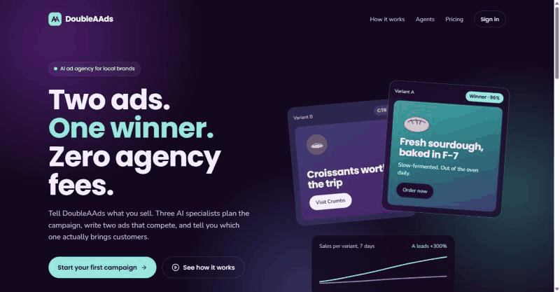
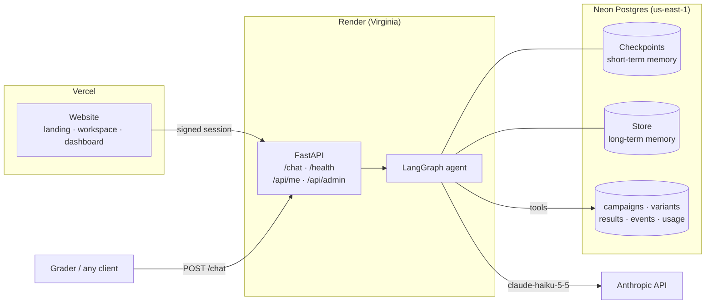
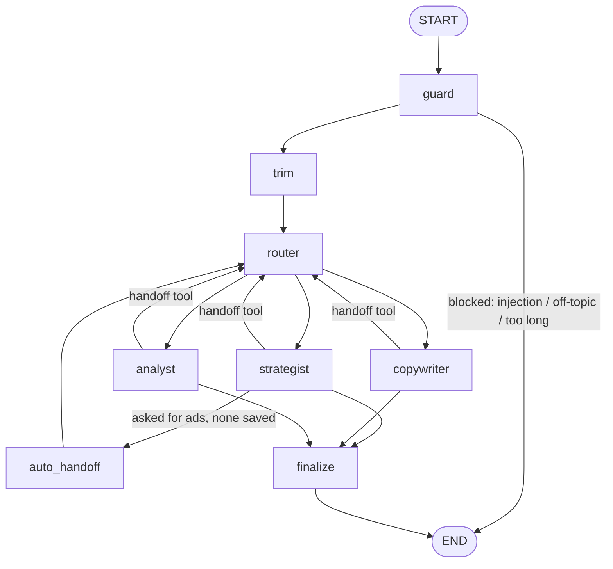

# DoubleAAds · AI ad agency for local brands

**Two ads. One winner. Zero agency fees.** DoubleAAds is a multi-agent ad agency (AdForge track) for small
local businesses: a **strategist**, a **copywriter** and an **analyst** plan a campaign, write two competing
ads with banners, ask before spending anything, and only name a winner when the numbers are statistically real.

| | |
|---|---|
| Live website | https://i230504i230786agenticworkshop-web.vercel.app |
| Agent API | https://doubleaads-api.onrender.com (`POST /chat`, `GET /health`) |
| Model | `claude-haiku-5-5` |
| Team (G09) | Areej Fahim (i230504) · Armish Tauqir (i230786) |



---

## The product

- **Customer:** small local brands that run their own Instagram/Facebook ads (bakeries, boutiques, salons, home bakers).
- **Problem:** agencies cost Rs 40k+ a month; doing it yourself wastes budget on rejected ads, no A/B testing,
  and no idea which ad actually sold.
- **How it earns:** monthly subscription. Starter Rs 3,999 (3 campaigns), Pro Rs 9,999 (unlimited, metrics dashboard).
- **Website:** landing page, agent workspace (chat + campaigns, banners, A/B result, brand memory) and an admin
  metrics dashboard (businesses, campaigns, blocked attacks, cost, latency, events).

## Architecture



### The agent graph



| Node | Job | Model call? |
|---|---|---|
| `guard` | Redacts card numbers and API keys, blocks prompt injection, off-topic and oversized messages | No (0 tokens) |
| `trim` | When a chat passes 30 messages, summarizes older turns and keeps the last 12 | Only when trimming |
| `router` | Picks the specialist by intent in code, keeps follow-ups with the active specialist, caps handoffs at 2 per turn | No |
| `strategist` | Creates, estimates and launches campaigns | Yes |
| `copywriter` | Writes 2 A/B variants, saves them (policy-checked), makes banners | Yes |
| `analyst` | Records results, runs the A/B test, explains CTR, conversion rate, cost per sale | Yes |
| `auto_handoff` | If the owner asked for ads and a campaign was created without any, hands it to the copywriter in code | No |
| `finalize` | Saves long-term facts from tool calls, blocks any reply that leaks the system prompt | No |

### Tools (11 + handoffs)

| Tool | What it does |
|---|---|
| `create_campaign` | Draft campaign; validates platform, goal, budget (≤ $1,000/day), days |
| `list_campaigns` | This business's campaigns only |
| `estimate_budget` | Impressions / clicks / conversions ranges from platform benchmarks |
| `check_ad_copy` | Platform length limits and banned claims ("guaranteed", "#1", cures…), normalized against obfuscation |
| `save_ad_variants` | Saves 1–5 variants; all must pass the policy check or none are saved |
| `list_ad_variants` | A campaign's variants |
| `make_creative` | Signed link to an SVG banner drawn from the ad copy (no image model, free) |
| `record_results` | Impressions, clicks, conversions, spend per variant (validated) |
| `analyze_ab_test` | Two-proportion z-test; names a winner only at 95% confidence |
| `launch_campaign` | Pauses with `interrupt()` for the owner's explicit yes before going live |
| `remember` | Saves a lasting brand fact (refuses anything sensitive) |
| `transfer_to_*` | Hand the chat to another specialist |

## Memory design

| | Short-term (per conversation) | Long-term (per business) |
|---|---|---|
| **What** | The messages of one chat, plus a summary once it passes 30 messages | Lasting facts: what they sell, audience, platforms, typical budget, tone of voice, last A/B winner |
| **Not stored** | — | Raw chat, card numbers, keys, passwords, one-off numbers |
| **Key** | `user_id::thread_id` | namespace `("brand", user_id)` |
| **Where** | LangGraph `PostgresSaver` in Neon | LangGraph `PostgresStore` in Neon |
| **How it's written** | Automatically, once per turn (`durability="exit"`) | Mostly by code from successful tool calls (0 extra tokens); the `remember` tool for stated preferences |
| **How it's used** | Sent to the model with each turn | Injected into the system prompt of every specialist |

**Keeping users separate:**
- `user_id` comes from the request (or a signed website session), **never from the model**: no tool has a user argument (a test enforces this).
- Every SQL query filters by `user_id`; someone else's campaign or variant id returns "not found".
- Thread keys include `user_id`, so two users sending the same `thread_id` never share a chat.
- Long-term memory lives in a per-user namespace.
- Website data routes need an HMAC-signed session token; banner images need a signed link.

## Safety

- **Input guard (0 tokens):** normalizes zero-width characters, full-width letters, spaced letters and leetspeak,
  then blocks instruction overrides, prompt extraction, role-play jailbreaks, fake system headers, cross-user
  requests and approval bypasses; declines off-topic requests (with an exception list so real ad requests pass).
- **Risky actions:** `launch_campaign` checks the campaign can launch, then pauses for an explicit "yes"
  ("yes but not now", "maybe" and anything hedged cancel). One launch per run at most.
- **Output guard:** a canary plus 8-word fingerprints of the confidential rules catch prompt leaks.
- **Abuse limits:** per-IP rate limit, a daily spend cap for the $2 key, PII redaction before anything is saved.

## Benchmark

<!-- BENCHMARK:START -->
_Run `python benchmark/run_benchmark.py` to fill this in._
<!-- BENCHMARK:END -->

`tests.json` holds our 10 test cases and the 5 common attack tests, each with inputs, the expected behaviour
and machine-checkable assertions. `benchmark/run_benchmark.py` runs them against any deployment.

## Cost and speed

- Haiku 5.5 at `effort: low`, replies capped at 1,024 tokens.
- The router, guard, trimming decision, memory capture and output guard are code, not model calls.
- Blocked requests cost 0 tokens. Tools return short text; old bulky tool results are cleared from context.
- Postgres connection pool with autocommit and one checkpoint write per turn
  (measured: 15 s → 3.5 s per turn from Pakistan; ~2.6 s average on Render next to the database).

## API

```http
POST /chat
{"user_id": "u1", "thread_id": "t1", "message": "Make 2 Instagram ads for my bakery, $20/day for a week"}

200 {"reply": "...", "tool_calls": [{"name": "create_campaign", "args": {...}}], "tokens": {"in": 7748, "out": 797}}
```

`GET /health` → `ok`. Errors keep the same JSON shape (422 bad input, 429 rate limit, 503 outage or daily cap).
To approve a launch, the next `/chat` message on the same thread is the answer ("yes" / "no").

## Run it locally

```bash
python -m venv .venv
.venv/Scripts/activate            # macOS/Linux: source .venv/bin/activate
pip install -r requirements-dev.txt
cp .env.example .env              # add ANTHROPIC_API_KEY; DATABASE_URL optional (SQLite + in-memory without it)
uvicorn app.api:app --reload      # API on http://127.0.0.1:8000
python -m http.server 5173 --directory web    # website on http://127.0.0.1:5173
```

To point the local website at the local API, run this once in the browser console:
`localStorage.setItem("daa.api", JSON.stringify("http://127.0.0.1:8000"))`.

**Tests** (no model calls, free): `pytest -q` (SQLite) or `TEST_PG=1 pytest -q` (against `DATABASE_URL`).
227 tests cover the tools, adversarial guard inputs, fuzzing, isolation through every tool, the graph,
both memories and the API contract.

## Deploy

- **API:** Render Blueprint from `render.yaml` (free plan, Virginia). Secrets: `ANTHROPIC_API_KEY`,
  `DATABASE_URL`, `ADMIN_PASSWORD`, `SECRET_KEY`. `.github/workflows/keepalive.yml` pings `/health` every
  10 minutes (set the repo variable `API_URL`) so the free instance doesn't sleep.
- **Website:** Vercel, root directory `web`, framework "Other", no build step.
- **Database:** Neon Postgres in us-east-1; tables are created on first start.

## Project structure

```
app/
  api.py         FastAPI: graded endpoints, website and admin routes, limits
  graph.py       LangGraph: guard, trim, router, specialists, auto_handoff, finalize
  middleware.py  prompts, input/output guards, PII redaction, per-agent middleware
  tools.py       agent tools and handoffs
  ads.py         business logic (campaigns, copy policy, estimates, A/B statistics)
  memory.py      checkpointer, store, long-term fact capture, remember tool
  db.py · security.py · creatives.py · textnorm.py · context.py
web/             static website (Vercel)
tests/           pytest suite      tests.json   benchmark/   render.yaml
```

## Credits

- Icons: [Lucide](https://lucide.dev) v0.460.0 (ISC license), the same set svgrepo hosts as "Lucide".
- Fonts: Inter and Space Grotesk from Google Fonts (SIL Open Font License).
- Built with LangGraph, LangChain, FastAPI and Claude, starting from the Anviro workshop patterns.
